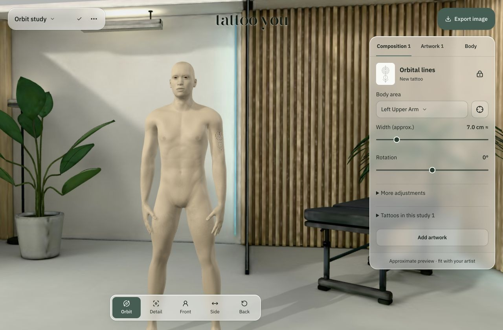
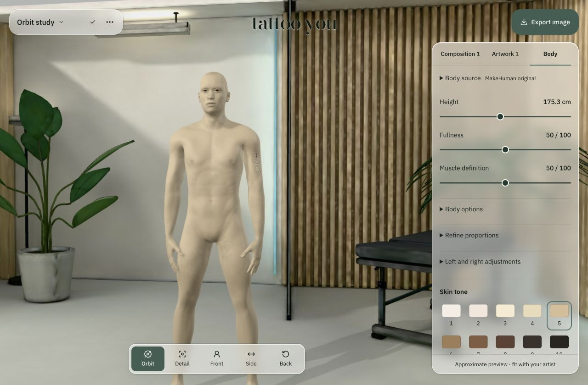
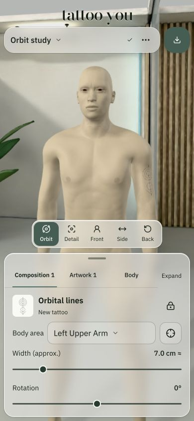

# tattoo you

A browser app for trying tattoo placement on a 3D body. Import artwork, adjust its position and size, compare arrangements, and export a reference for your artist. The preview is approximate; confirm the final fit on your body.



The studio has a reusable artwork library, adjustable body references, named studies, notes, undo/redo, and workspace backups. Existing tattoos can be positioned and locked while you try new additions. Phones use a draggable controls panel.

## Run locally

Requires Git and Node.js 24 or newer, including npm.

```sh
git clone --depth 1 https://github.com/potalora/tattoo-you.git && cd tattoo-you && npm ci && npm run build && npm start
```

Open [tattoo you](http://127.0.0.1:8788/studio/) and leave the terminal running. Stop with Ctrl-C. For later launches, run `npm start` from the `tattoo-you` folder. The server runs locally; a Cloudflare account is not required.

Studies and artwork save in the current browser. Different browsers and site addresses have separate workspaces. Download a workspace backup before clearing browser data or moving between devices. Restore replaces the current workspace.

Import a tightly cropped, transparent PNG or WebP up to 20 MB. Photos of tattoos on skin need preparation outside the app.

## Screenshots

Body controls and the phone layout. All screenshots use an original geometric demo design, with no private artwork or studies.





## Development

The interface uses React, Base UI and Motion. Three.js owns the 3D view, with WebGPU and a WebGL fallback. Fonts, artwork and rendering dependencies are served locally.

```sh
npm run build:ui
npm test
npm run build
```

UI source is in `studio/ui/`; the geometry kernel source is in `studio/wasm/`. Keep the generated `studio/ui-app.js` and `studio/ui-app.css` with source changes. The public build uses the explicit file list in `public/runtime-assets.json`.

See [frontend architecture and interface behavior](docs/frontend.md) and [screenshot provenance](docs/images/README.md). The application source uses the [MIT License](LICENSE). Third-party components and assets retain their own licenses; see [ASSET-NOTICES.md](ASSET-NOTICES.md).

Existing Inkform browser storage names and backup formats are retained.
